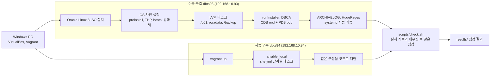

# oracle19c-install

Oracle 19c를 손으로 30단계에 걸쳐 구축하고, 같은 구성을 Ansible로 29분 만에 재현해 두 방법을 같은 점검 스크립트로 비교한 실습이다.

## 구성도



## 한 일

- VirtualBox에 VM을 만들고 Oracle Linux 8을 ISO로 설치한 뒤, OS 설정부터 DB 생성, 운영 설정까지 30단계를 직접 입력해 구축했다. 단계마다 기대값과 실제 결과를 기록했다 (`docs/manual-install-guide.md`, `docs/manual-install-log.md`).
- 같은 구성을 Vagrant와 Ansible로 코드화했다. `vagrant up` 한 번으로 OS 준비, 디스크, 소프트웨어 설치, 리스너, DB 생성, ARCHIVELOG, 자동 기동, HugePages, 점검까지 이어진다 (`automation/`).
- 운영 설정을 넣었다. CDB와 PDB, ARCHIVELOG 모드, HugePages(`use_large_pages=ONLY`), THP 끄기, 방화벽은 끄지 않고 리스너 포트만 허용, 부팅 시 DB와 리스너 자동 기동(oratab + systemd).
- 점검 스크립트 `check.sh` 하나로 디스크, OS 설정, 소프트웨어, 서비스와 리스너, DB 상태, HugePages, 외부 접속 준비를 확인했다. 설치 직후와 재부팅 후에 같은 스크립트를 돌려 결과를 비교했다.
- 자동화 단계는 다시 실행해도 안전하게 만들었다. 이미 끝난 단계는 건너뛰고, 태그로 일부 단계만 다시 돌릴 수 있다.

## 결과 숫자

| 항목 | 결과 |
|---|---|
| 수동 구축 | OS 설치부터 CDB, PDB, ARCHIVELOG, HugePages, 자동 기동까지 30단계 |
| 수동 구축 점검 | 재부팅 후 점검 17항목 모두 통과 |
| Ansible 재현 | 같은 구성을 29분 만에 재현 |
| Ansible 재현 점검 | 같은 점검 스크립트로 실패 항목 없음 (Oracle 공식 박스는 firewalld가 꺼져 있어 방화벽 항목은 건너뛴다) |

점검 결과 원문은 `results/` 에 있다. 수동 구축 VM(dbts93)의 점검 결과 파일은 아직 VM 안에 있어 이 저장소에는 넣지 않았다.

## 겪은 문제와 해결

### 1. systemd가 dbstart 실행을 거부했다 (SELinux)
- 증상: 자동 기동 단계에서 `oracle-db.service` 가 `status=203/EXEC Permission denied` 로 실패했다 (`results/ansible_run1_selinux_fail.log`).
- 원인: 새로 만든 xfs 파일 시스템에는 SELinux 라벨이 없어(`unlabeled_t`) systemd가 `/u01` 아래 실행 파일을 직접 실행하지 못했다. 파일 권한 문제가 아니었다.
- 해결: 디스크를 마운트한 뒤 `restorecon` 으로 정책 기본 라벨을 복원하고, 서비스 파일은 시스템 셸을 거쳐 `dbstart` 를 실행하게 바꿨다 (`ExecStart=/bin/bash -c '…/dbstart …'`).
- 이유: SELinux를 끄면 바로 넘어가지만 운영 서버에서 보안 기능을 끄는 습관은 남기지 않으려 했다. 라벨을 고쳐 enforcing 상태 그대로 통과시켰다.

### 2. 재기동 뒤 리스너에 pdb 서비스가 없었다
- 증상: 수동 구축 점검에서 `리스너에 pdb 서비스 없음` 항목만 실패했다. DB와 PDB는 정상이었다.
- 원인: DBCA는 `local_listener=LISTENER_ORCL` 로 설정하고 그 별칭을 `tnsnames.ora` 에 적어 둔다. 가이드에서 이 파일을 덮어쓰기(`>`)로 만들어 별칭이 지워졌고, DB를 다시 올렸을 때 동적 등록에 실패했다.
- 해결: 별칭을 덧붙이고(`>>`) `local_listener` 를 같은 값으로 다시 설정한 뒤 `alter system register` 를 실행했다.
- 이유: DB는 `local_listener` 값을 설정될 때 한 번 풀어서 기억한다. 파일만 고치고 `register` 만 하면 반영되지 않아 값을 다시 설정해야 했다.

### 3. DBCA 기본값이 HugePages와 접속을 막았다
- 증상: 메모리 기본값이 AMM이었고, 데이터 파일 위치가 `/u01` 쪽 기본 경로였고, DB 이름 뒤에 `.localdomain` 이 자동으로 붙었다.
- 원인: DBCA 화면의 기본 선택값을 그대로 두면 생기는 값이다. AMM이면 `memory_target` 이 생겨 HugePages를 쓸 수 없고, `db_domain` 이 생기면 서비스 이름이 달라져 접속이 실패한다.
- 해결: 마지막 Summary 화면에서 값을 확인해 찾아내고, Back으로 돌아가 ASMM, `/oradata`, `orcl` 로 고쳤다. 자동판은 `-memoryMgmtType AUTO_SGA` 로 고정하고 생성 직후 `memory_target=0` 을 검사한다.
- 이유: 설치가 끝난 뒤에는 되돌리기 어려운 값이라 생성 전에 막는 것이 가장 싸다.

### 4. DBCA 화면이 멈춘 것처럼 보였다
- 증상: 진행 화면이 한 지점에서 오래 멈췄다.
- 원인: DB 생성은 이미 끝났지만 파일 복사 단계의 RMAN 프로세스가 끝나지 않아 화면이 넘어가지 않은 것으로 판단했다 (추정).
- 해결: 창을 닫지 않고 DBCA 로그, alert log, `show pdbs`, 리스너 상태를 차례로 확인해 생성 완료를 판단한 뒤 정리했다.
- 이유: 화면보다 로그와 DB의 실제 상태가 정확하다. 화면만 보고 강제 종료했다면 멀쩡한 DB를 다시 만들 뻔했다.

### 5. NAT 어댑터에 IP가 없었다
- 증상: 첫 로그인 뒤 NAT 쪽 인터페이스에 IP와 기본 경로가 없었다.
- 원인: 설치 화면에서 켠 연결이 `autoconnect=no` 로 저장됐다.
- 해결: `nmcli con mod <연결> connection.autoconnect yes` 로 바꾸고 연결을 올렸다.
- 이유: `con up` 만 하면 재부팅할 때 다시 꺼진다. 재부팅 점검을 통과하려면 자동 연결 설정이 필요했다.

수동 구축에서 겪은 문제 전체(원인, 해결, 이유)는 `docs/manual-install-log.md` 에 있다.

## 따라 하는 법

설치 파일 `LINUX.X64_193000_db_home.zip` 은 라이선스 때문에 이 저장소에 없다. Oracle 사이트에서 직접 받는다. 패치(RU, OPatch) 파일도 같다.

준비

1. 저장소 폴더 안(`automation` 폴더 옆)에 `media` 폴더를 만들고 설치 zip을 넣는다. `.gitignore` 에 들어 있어 올라가지 않는다.
2. `automation/ansible/vars.yml` 의 `db_password` 를 직접 정한 값으로 바꾼다.

PowerShell

```powershell
cd automation
```
```powershell
powershell -ExecutionPolicy Bypass -File scripts\check-host.ps1
```
```powershell
vagrant up
```
```powershell
vagrant ssh -c "sudo bash /vagrant/scripts/check.sh"
```
```powershell
vagrant reload
```
```powershell
vagrant ssh -c "sudo bash /vagrant/scripts/check.sh"
```

일부 단계만 다시 실행

```powershell
$env:ORA_TAGS="hugepages,verify"
```
```powershell
vagrant provision --provision-with oracle
```

지우기

```powershell
vagrant destroy -f
```

수동 구축은 `docs/manual-install-guide.md` 의 단계를 순서대로 따른다.

## 폴더

| 위치 | 내용 |
|---|---|
| `automation/Vagrantfile` | VM, 추가 디스크, Ansible 실행 정의 |
| `automation/ansible/` | `site.yml` 과 단계별 태스크, 템플릿, 변수 |
| `automation/scripts/check.sh` | 설치 직후와 재부팅 후 공용 점검 스크립트 |
| `automation/scripts/check-host.ps1` | `vagrant up` 전에 PC 조건을 검사하는 스크립트 |
| `docs/manual-install-guide.md` | 수동 구축 30단계 가이드 |
| `docs/manual-install-log.md` | 수동 구축 실행 기록과 문제 해결 |
| `docs/automation-tech-report.md` | 자동화 설계와 검증 기술서 |
| `results/` | 자동 구축 점검 결과와 Ansible 실행 로그 |

문서 안의 비밀번호는 모두 `<비밀번호>` 로 바꿔 두었다.
